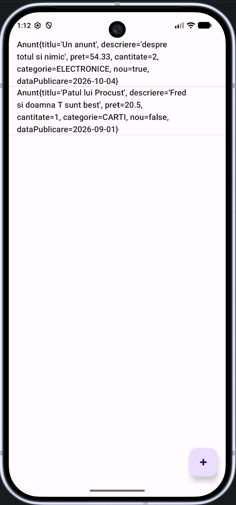

# 04 - Listă și CRUD în memorie

## Obiective

- să înțelegeți ce este un **Adapter** și de ce lista de pe ecran nu „ține” singură obiectele;
- să puneți un `ListView` pe `activity_main.xml`, lângă FAB-ul din Seminarul 2;
- să țineți colecția în memorie ca `List<...>` și să o umpleți cu `ArrayList`;
- să faceți **CRUD**: adăugare (din Activity Result), citire (afișare), editare (click), ștergere (long-click + `AlertDialog`);
- să recunoașteți `RecyclerView` ca alternativă modernă (cu un exemplu scurt), fără să înlocuiți `ListView` în laborator.

## De unde porniți

- Starea de la finalul Seminarului 3 (tag `Seminar_3-grupa1086` sau `Seminar_3-grupa1088`, ori branch-ul grupei: `git pull` sau **Clone Repository** din Android Studio - vezi [README](../README.md)).
- `AddActivity` întoarce deja un `Anunt` / `Abonament` prin Intent. În `MainActivity`, callback-ul (sau `onActivityResult`) arată deocamdată un Toast. Acum obiectul intră în listă.

## 1. CRUD și stocare temporară

**CRUD** sunt cele patru operații pe o colecție:

| Literă | Semnificație | În aplicația noastră                           |
| ------ | ------------ | ---------------------------------------------- |
| C      | Create       | adăugare (FAB → formular → rezultat OK)        |
| R      | Read         | afișare în `ListView`                          |
| U      | Update       | click pe rând → același formular, precompletat |
| D      | Delete       | long-click → dialog de confirmare              |

Colecția trăiește în `MainActivity`, în RAM. Când procesul aplicației se închide, lista se golește. Persistarea pe disc o vom acoperi într-un seminar viitor. Acum vă interesează fluxul: **formular → obiect → listă vizibilă**.

## 2. ListView și Adapter

Un `ListView` este un view derulabil cu **rânduri**. El nu stochează `Anunt` / `Abonament`. Între colecția voastră și ecran stă un **Adapter**:

- câte rânduri sunt (`getCount`);
- ce obiect e la o poziție (`getItem`);
- cum arată rândul (`getView`).

`ArrayAdapter` cu layout-ul gata din SDK, `android.R.layout.simple_list_item_1`, face un rând cu un singur `TextView`. Textul vine din `toString()`-ul modelului. Dacă `toString()` e slab (de exemplu doar numele clasei), lista arată inutil. Completați-l cu ceva lizibil: titlu și preț, sau nume și cost.

Documentație: [ListView](https://developer.android.com/reference/android/widget/ListView), [ArrayAdapter](https://developer.android.com/reference/android/widget/ArrayAdapter)

## 3. Colecția: interfață `List`, implementare `ArrayList`

În Java, programați pe **interfață** și alegeți **implementarea** la construire. `List` spune _ce_ puteți face (`add`, `get`, `set`, `remove`, `size`). `ArrayList` spune _cum_ e stocat (vector dinamic). Dacă mâine treceți pe `LinkedList`, restul codului care folosește `List` rămâne la fel.

```java
import java.util.ArrayList;
import java.util.List;

private final List<Anunt> anunturi = new ArrayList<>();
private ArrayAdapter<Anunt> adapter;
```

Pe 1088: `List<Abonament> abonamente = new ArrayList<>();`.

Nu declarați câmpul ca `ArrayList<Anunt>`: specializarea stă în `new`, nu în tipul referinței.

## 4. Layout: ListView pe ecranul principal

Lucrați în `activity_main.xml`, nu în formularul de adăugare. `activity_add.xml` rămâne ecranul de adăugare al obiectelor. Pe principal aveți deja FAB-ul `fabAdauga` (colț dreapta-jos). Lista ocupă restul ecranului; FAB-ul stă **deasupra** listei (în XML, după `ListView`, ca să fie desenat ultimul).

Rădăcina e tot **ConstraintLayout**. `ListView` se întinde pe tot părintele: lățime și înălțime `0dp`, start / end / top / bottom legate de `parent`. Fără constrângeri, la rulare sare în `(0, 0)`, ca orice view din Seminarul 1.

Scoateți `TextView`-ul „Hello” și butonul de Toast / `SecondActivity` din seminarul întâi, dacă încă sunt pe ecran: locul lor îl ia lista.

```xml
<ListView
    android:id="@+id/lvElemente"
    android:layout_width="0dp"
    android:layout_height="0dp"
    app:layout_constraintBottom_toBottomOf="parent"
    app:layout_constraintEnd_toEndOf="parent"
    app:layout_constraintStart_toStartOf="parent"
    app:layout_constraintTop_toTopOf="parent" />
```

FAB-ul rămâne cum l-ați pus în Seminarul 2 (`constraintBottom` / `constraintEnd` pe părinte, `layout_margin="16dp"`). Nu îl legați sub listă: atunci ar împinge lista sau ar ieși din ecran.

După **Sync** / rebuild, View Binding generează `binding.lvElemente`.

## 5. Legarea adapterului în `onCreate`

După `inflate`, `setContentView` și listener-ul de insets:

```java
adapter = new ArrayAdapter<>(this, android.R.layout.simple_list_item_1, anunturi);
binding.lvElemente.setAdapter(adapter);
```

`this` e Context-ul Activity (ca la Spinner în Seminarul 2). Al doilea argument este layout-ul **unui rând**, nu al întregului ecran. Prefixul `android.R` îl deosebește de `R` al aplicației: `R.layout.activity_main` e fișierul vostru din `res/layout`; `android.R.layout.simple_list_item_1` e un XML livrat de platformă, gata de folosit, fără să îl copiați în proiect.

`simple_list_item_1` conține un singur `TextView` cu id-ul `android.R.id.text1`. `ArrayAdapter` umple acel text cu `toString()` pe fiecare element. De aceea, pentru acest constructor, layout-ul trebuie să aibă un `TextView` numit `text1`. Există și alte layout-uri de același fel în [android.R.layout](https://developer.android.com/reference/android/R.layout), de exemplu:

| Resursă                    | Ce afișează                                                                          |
| -------------------------- | ------------------------------------------------------------------------------------ |
| `simple_list_item_1`       | un rând, un text (cel folosit aici)                                                  |
| `simple_list_item_2`       | un rând cu titlu și subtitlu (`text1` și `text2`; cere constructorul cu două id-uri) |
| `simple_list_item_checked` | un text plus o bifă                                                                  |
| `simple_spinner_item`      | rândul din Spinner-ul din Seminarul 2                                                |

Le puteți deschide din Android Studio: click pe `simple_list_item_1` ținând Ctrl (sau Cmd), ca să vedeți XML-ul din SDK.

Când schimbați lista (`add`, `set`, `remove`), ecranul **nu** se actualizează singur. Apelați `adapter.notifyDataSetChanged()`. Fără el, memoria e la zi, lista vizibilă nu.

## 6. Adăugare (Create)

În callback-ul de la Seminarul 3, în loc de (sau pe lângă) Toast:

```java
if (result.getResultCode() == RESULT_OK && result.getData() != null) {
    Anunt anunt = IntentCompat.getSerializableExtra(
            result.getData(), "element", Anunt.class);
    // sau getParcelableExtra, dacă ați ales Parcelable
    if (anunt != null) {
        anunturi.add(anunt);
        adapter.notifyDataSetChanged();
    }
}
```

Pe 1088: `Abonament` și `abonamente`. FAB-ul tot lansează `AddActivity` cu `addLauncher.launch(...)`.

Rezultatul așteptat (listă cu câteva elemente și FAB jos-dreapta):



## 7. Editare (Update)

Click-ul pe un rând deschide **același** `AddActivity`, dar cu datele obiectului populate în câmpurile formularului. La întoarcere **înlocuiți** elementul, nu mai adăugați unul.

Listener-ul de click vă dă `position`: indexul rândului în `List` (0, 1, 2, …). Obiectul din extras (`"element"`) e de ajuns ca să **umpleți** formularul. Ca să **puneți înapoi** rezultatul în colecție, `MainActivity` trebuie să știe **care** loc din listă se actualizează: `anunturi.set(index, obiectNou)`. Fără index ați face `add` și ați duplica rândul.

De aceea, pe lângă obiect, puneți în Intent un întreg, `POZ_SELECTIE`: poziția elementului selectat. La adăugare (FAB) nu trimiteți cheia, sau o citiți cu implicit `-1`. Dacă valoarea e ≥ 0, e editare; dacă e `-1`, e adăugare.

Puteți reutiliza același launcher. Cheia trebuie să fie **identică** pe ambele ecrane (aceeași constantă, copiată, sau un `public static final` comun).

În `MainActivity`:

```java
public static final String POZ_SELECTIE = "pozSelectie";

binding.lvElemente.setOnItemClickListener((parent, view, position, id) -> {
    Anunt selectat = anunturi.get(position);
    Intent intent = new Intent(this, AddActivity.class);
    intent.putExtra("element", selectat);
    intent.putExtra(POZ_SELECTIE, position);
    addLauncher.launch(intent);
});
```

În callback, după ce citiți obiectul:

```java
int pozSelectie = result.getData().getIntExtra(POZ_SELECTIE, -1);
if (pozSelectie >= 0) {
    anunturi.set(pozSelectie, anunt);
} else {
    anunturi.add(anunt);
}
adapter.notifyDataSetChanged();
```

În `AddActivity`, în `onCreate` (după binding), dacă Intent-ul aduce un obiect, precompletați câmpurile asociate acestuia. Citiți și `POZ_SELECTIE` (același nume de cheie ca în `MainActivity`). La Salvează, puneți-o înapoi pe Intent-ul de rezultat, ca `MainActivity` să știe unde să facă `set`.

`getIntent()` întoarce Intent-ul cu care **a fost pornită** această Activity: extras-urile puse de `MainActivity` la `launch` (obiectul și, la editare, poziția). Nu e Intent-ul pe care îl construiți voi la `setResult`; acela e alt obiect, pentru drumul înapoi. Fără `getIntent()`, `AddActivity` nu are de unde să știe dacă e adăugare sau editare.

Fiecare control se completează cu metoda lui, nu cu `setText` pe toate. `EditText` moștenește `setText` de la `TextView`: primește `String` sau `CharSequence`. Numerele din model (`double`, `int`) trebuie convertite cu `String.valueOf`. Data e `LocalDate`: o treceți prin `format`, același formatter ca la citire. La Spinner, `setSelection(int)` alege rândul după **index** în adapter. La RadioGroup, `check(id)` bifează butonul cu acel id; celelalte din grup se debifează singure.

Pentru Spinner aveți nevoie de drumul invers față de Seminarul 2: din constanta enum, înapoi la textul din listă. În Seminarul 2 ați pus pe enum `dinEticheta` (șir → constantă). Adăugați pe **același enum** metoda opusă, tot cu `return switch`. Pe 1086, în `Categorie`:

```java
public static String etichetaDin(Categorie categorie) {
    return switch (categorie) {
        case ELECTRONICE -> "Electronice";
        case CARTI -> "Cărți";
        case IMBRACAMINTE -> "Îmbrăcăminte";
        case ALTELE -> "Altele";
    };
}
```

Șirurile trebuie să fie **aceleași** ca în Spinner (și ca în `dinEticheta`). Pe 1088: `Frecventa.etichetaDin(...)`, cu `"Lunar"`, `"Anual"`, `"Săptămânal"`. Nu puneți metoda în `AddActivity` sau în model: enum-ul rămâne locul comun pentru etichetă ↔ constantă.

Apoi, în `AddActivity`, precompletați:

```java
Anunt existent = IntentCompat.getSerializableExtra(
        getIntent(), "element", Anunt.class);
// dacă ați ales Parcelable: IntentCompat.getParcelableExtra(getIntent(), "element", Anunt.class);
int pozSelectie = getIntent().getIntExtra(MainActivity.POZ_SELECTIE, -1);
if (existent != null) {
    binding.etTitlu.setText(existent.getTitlu());
    binding.etDescriere.setText(existent.getDescriere());
    binding.etPret.setText(String.valueOf(existent.getPret()));
    binding.etCantitate.setText(String.valueOf(existent.getCantitate()));
    binding.spCategorie.setSelection(
            adapter.getPosition(Categorie.etichetaDin(existent.getCategorie())));
    if (existent.isNou()) {
        binding.rgStare.check(binding.rbNou.getId());
    } else {
        binding.rgStare.check(binding.rbFolosit.getId());
    }
    binding.etDataPublicare.setText(
            existent.getDataPublicare().format(DateTimeFormatter.ISO_LOCAL_DATE));
}
```

La 1088: `etNume` / `getNume()`, `etObservatii`, `etCost` / `getCost()`, `etNrPersoane` / `getNrPersoane()`, `spFrecventa` cu `Frecventa.etichetaDin(...)`, `rgStatus.check` pe `rbActiv` sau `rbAnulat` după `isActiv()`, `etDataReinnoire` cu `getDataReinnoire().format(...)`.

Obiectul primit din listă a trecut deja validarea de la Salvează (Seminarul 3), altfel nu ar fi ajuns în colecție. La precompletare **nu** mai verificați câmpurile lui cu `setError`. Validarea din listener-ul de Salvează rămâne: utilizatorul poate goli un câmp sau introduce un preț invalid înainte de a confirma editarea.

La `setResult`:

```java
data.putExtra("element", anunt);
if (pozSelectie >= 0) {
    data.putExtra(MainActivity.POZ_SELECTIE, pozSelectie);
}
```

Validarea rămâne cea din Seminarul 3: fără `RESULT_OK` dacă formularul e invalid.

Documentație: [AdapterView.OnItemClickListener](https://developer.android.com/reference/android/widget/AdapterView.OnItemClickListener), [Activity.getIntent()](<https://developer.android.com/reference/android/app/Activity#getIntent()>), [TextView.setText](<https://developer.android.com/reference/android/widget/TextView#setText(java.lang.CharSequence)>), [Spinner.setSelection](<https://developer.android.com/reference/android/widget/AbsSpinner#setSelection(int)>), [ArrayAdapter.getPosition](<https://developer.android.com/reference/android/widget/ArrayAdapter#getPosition(T)>), [RadioGroup.check](<https://developer.android.com/reference/android/widget/RadioGroup#check(int)>)

## 8. Ștergere și AlertDialog

Un **dialog** e o fereastră mică peste Activity. `AlertDialog` e potrivit pentru „Sigur ștergeți?”. Long-click-ul e gestul secundar: click scurt = editare, ținere = ștergere.

```java
binding.lvElemente.setOnItemLongClickListener((parent, view, position, id) -> {
    new AlertDialog.Builder(this)
            .setTitle("Ștergere")
            .setMessage("Ștergeți elementul selectat?")
            .setPositiveButton("Da", (d, w) -> {
                anunturi.remove(position);
                adapter.notifyDataSetChanged();
            })
            .setNegativeButton("Nu", null)
            .show();
    return true;
});
```

`return true` spune că evenimentul a fost consumat. Dacă întoarceți `false`, sistemul poate trata și un click simplu imediat după, și ați deschide formularul de editare.

Documentație: [AdapterView.OnItemLongClickListener](https://developer.android.com/reference/android/widget/AdapterView.OnItemLongClickListener), [AlertDialog](https://developer.android.com/reference/androidx/appcompat/app/AlertDialog)

## 9. RecyclerView, ca alternativă modernă

În proiectele Views actuale, listele lungi se fac de obicei cu `RecyclerView`, nu cu `ListView`. Forțează **ViewHolder** (reutilizarea rândurilor la derulare), animații și layout-uri (liniar, grilă). În Jetpack Compose, ideea similară e `LazyColumn` (Kotlin); noi rămânem cu exemplul pe Views.

CRUD-ul din ora aceasta rămâne pe `ListView`. Într-un seminar viitor personalizăm tot `ListView`: layout propriu de rând și adapter scris de noi. `RecyclerView` poate fi folosit în live assignments, probele practice sau în proiectele personale, ca alternativă la `ListView`.

Mai întâi puneți widget-ul în `activity_main.xml`, în locul lui `ListView` (aceleași constrângeri, id `rvElemente`). După rebuild, View Binding vă dă posibilitatea să-l referiți prin `binding.rvElemente`.

```xml
<androidx.recyclerview.widget.RecyclerView
    android:id="@+id/rvElemente"
    android:layout_width="0dp"
    android:layout_height="0dp"
    app:layout_constraintBottom_toBottomOf="parent"
    app:layout_constraintEnd_toEndOf="parent"
    app:layout_constraintStart_toStartOf="parent"
    app:layout_constraintTop_toTopOf="parent" />
```

Colecția rămâne `List<Anunt>` (sau `List<Abonament>`), construită cu `new ArrayList<>()`.

### LayoutManager: de ce `RecyclerView` nu e „lista” singură

`ListView` știe din construcție cum așază rândurile: una sub alta, pe verticală. `RecyclerView` nu presupune asta automat. El reciclează view-uri; **cum** le pune pe ecran e treaba unui `LayoutManager`. Fără el, lista e goală, chiar dacă adapterul are date.

Pentru o listă clasică, creați un `LinearLayoutManager`. Constructorul `LinearLayoutManager(Context)` primește un `Context`; `Activity` este un `Context`, deci `this` din `MainActivity` e potrivit. Implicit, orientarea e verticală (`LinearLayoutManager.VERTICAL`), de sus în jos. Există și suprascrierea `LinearLayoutManager(context, orientare, reverseLayout)`, plus `GridLayoutManager` dacă vreți mai multe coloane.

Abia acum, pe view-ul din XML, apelați `setLayoutManager` **înainte** de `setAdapter`:

```java
binding.rvElemente.setLayoutManager(new LinearLayoutManager(this));
```

### De ce un adapter propriu

`ArrayAdapter` e făcut pentru `ListView` (`BaseAdapter`). `RecyclerView` cere un `RecyclerView.Adapter`. Nu puteți pune același `ArrayAdapter` pe ambele widget-uri. Scrieți o clasă care știe: câte elemente sunt, cum se adaugă un rând nou la view, și cum se populează un rând reciclat.

Semnătura `class AnuntAdapter extends RecyclerView.Adapter<AnuntAdapter.VH>` se citește așa:

- `RecyclerView.Adapter` e clasa abstractă a platformei;
- parametrul generic e **tipul de ViewHolder** pe care îl folosește acest adapter;
- `AnuntAdapter.VH` înseamnă clasa internă `VH` din `AnuntAdapter`. Compilatorul știe atunci că `onCreateViewHolder` întoarce `VH` și că `onBindViewHolder` primește `VH`, fără cast.

`VH` e o prescurtare pentru ViewHolder. Numele poate fi orice, de exemplu chiar și `AnuntViewHolder`; important e să **extindă** `RecyclerView.ViewHolder` și să fie public, la fel ca metodele `onCreateViewHolder` și `onBindViewHolder` din clasa extinsă.

### ViewHolder, `onCreateViewHolder`, `onBindViewHolder`

La `ListView` + `ArrayAdapter`, totul trecea prin `getView`: uneori foloseați `inflate`, alteori refoloseați `convertView`. `RecyclerView` desparte cele două momente.

**ViewHolder-ul** ține referințe la view-urile dintr-un rând (`TextView`-ul cu textul). `findViewById` se face o dată, la construirea holder-ului, nu de fiecare dată când rândul reapare pe ecran. Constructorul `RecyclerView.ViewHolder` cere view-ul rădăcină al rândului: `super(itemView)`. Câmpul `itemView` e tot rândul; pe el puneți click-urile.

**onCreateViewHolder** se apelează când `RecyclerView` are nevoie de un **rând nou** (nu mai are destule de reciclat). Trebuie să dați `inflate` layout-ului și să îl împachetați într-un `VH`. `parent` e `RecyclerView`-ul; `false` la `inflate` înseamnă „nu atașa încă la părinte”: `RecyclerView` atașează el, după ce LayoutManager decide locul.

**onBindViewHolder** se apelează de fiecare dată când un holder **deja creat** trebuie să arate alt element: derulați, un rând iese sus, altul intră jos, același `VH` primește obiectul de la `position`. Aici puneți textul, nu apelați `inflate` din nou.

**getItemCount** spune câte rânduri sunt. Dacă întoarceți 0, ecranul e gol.

```java
public class AnuntAdapter extends RecyclerView.Adapter<AnuntAdapter.VH> {

    public interface ActiuniRand {
        void laClick(int position);
        void laLongClick(int position);
    }

    private final List<Anunt> date;
    private final ActiuniRand actiuni;

    public AnuntAdapter(List<Anunt> date, ActiuniRand actiuni) {
        this.date = date;
        this.actiuni = actiuni;
    }

    public static class VH extends RecyclerView.ViewHolder {
        final TextView text;

        VH(@NonNull View itemView, ActiuniRand actiuni) {
            super(itemView);
            text = itemView.findViewById(android.R.id.text1);
            itemView.setOnClickListener(v -> {
                int poz = getAdapterPosition();
                if (poz != RecyclerView.NO_POSITION) {
                    actiuni.laClick(poz);
                }
            });
            itemView.setOnLongClickListener(v -> {
                int poz = getAdapterPosition();
                if (poz == RecyclerView.NO_POSITION) {
                    return false;
                }
                actiuni.laLongClick(poz);
                return true;
            });
        }
    }

    @NonNull
    @Override
    public VH onCreateViewHolder(@NonNull ViewGroup parent, int viewType) {
        View rand = LayoutInflater.from(parent.getContext())
                .inflate(android.R.layout.simple_list_item_1, parent, false);
        return new VH(rand, actiuni);
    }

    @Override
    public void onBindViewHolder(@NonNull VH holder, int position) {
        holder.text.setText(date.get(position).toString());
    }

    @Override
    public int getItemCount() {
        return date.size();
    }
}
```

Listener-ele stau în constructorul lui `VH`, nu în `onBindViewHolder`. `onBind` rulează des; click-ul nu trebuie recreat de fiecare dată. Poziția **nu** o capturați ca variabilă din `onBind`: după o inserare sau o ștergere, același holder poate corespunde altui index. `getAdapterPosition()` (pe `RecyclerView.ViewHolder`) întoarce indexul **curent** al rândului în adapter. Dacă holder-ul nu e legat de un element, valoarea e `RecyclerView.NO_POSITION` și ignorați evenimentul.

La 1088, aceeași clasă cu `List<Abonament>` și numele `AbonamentAdapter`.

### Click și long-click: paralela cu `ListView`

Pe `ListView` ați scris pe **listă**:

```java
binding.lvElemente.setOnItemClickListener((parent, view, position, id) -> {
    // editare: extras cu obiectul și POZ_SELECTIE
});
binding.lvElemente.setOnItemLongClickListener((parent, view, position, id) -> {
    // AlertDialog, apoi remove(position)
    return true;
});
```

`RecyclerView` **nu** are `setOnItemClickListener` / `setOnItemLongClickListener`. Evenimentele sunt pe fiecare rând (`itemView`), iar poziția vine din holder, cum e în `VH` mai sus. În `MainActivity` treceți aceleași acțiuni prin `ActiuniRand`. Declarați `adapterRv` **câmp** (ca `adapter` la `ListView`), ca Java să permită apelul din clasa anonimă:

```java
private AnuntAdapter adapterRv;

adapterRv = new AnuntAdapter(anunturi, new AnuntAdapter.ActiuniRand() {
    @Override
    public void laClick(int position) {
        Intent intent = new Intent(MainActivity.this, AddActivity.class);
        intent.putExtra("element", anunturi.get(position));
        intent.putExtra(POZ_SELECTIE, position);
        launcher.launch(intent);
    }

    @Override
    public void laLongClick(int position) {
        new AlertDialog.Builder(MainActivity.this)
                .setTitle("Ștergere")
                .setMessage("Ștergeți elementul selectat?")
                .setPositiveButton("Da", (d, w) -> {
                    anunturi.remove(position);
                    adapterRv.notifyItemRemoved(position);
                })
                .setNegativeButton("Nu", null)
                .show();
    }
});
binding.rvElemente.setAdapter(adapterRv);
```

`return true` din lambda-ul lui `itemView.setOnLongClickListener` al constructorului din `VH` este pentru că `OnLongClickListener.onLongClick` întoarce `boolean`, spre deosebire de click-ul scurt. `true` înseamnă că evenimentul e consumat, deci nu mai pornește și `OnClickListener`-ul (editarea). `false` (când poziția e `NO_POSITION`) lasă evenimentul să circule mai departe.

În callback-ul de la `AddActivity`, în loc de `adapter.notifyDataSetChanged()` de la `ListView`:

```java
if (result.getResultCode() == RESULT_OK && result.getData() != null) {
    Anunt anunt = IntentCompat.getSerializableExtra(
            result.getData(), "element", Anunt.class);
    if (anunt != null) {
        int pozSelectie = result.getData().getIntExtra(POZ_SELECTIE, -1);
        if (pozSelectie >= 0) {
            anunturi.set(pozSelectie, anunt);
            adapterRv.notifyItemChanged(pozSelectie);
        } else {
            anunturi.add(anunt);
            adapterRv.notifyItemInserted(anunturi.size() - 1);
        }
    }
}
```

`notifyItemInserted` după `add` la sfârșitul listei folosește indexul noului element: `size() - 1`. `notifyItemChanged` după `set` redesenează doar rândul editat. `notifyItemRemoved` e deja în `laLongClick`, după `remove`.

### `notifyItemInserted` și restul: de ce `ListView` nu avea asta

După `add` / `set` / `remove` pe colecție, adapterul trebuie anunțat. Pe `ArrayAdapter` ați avut practic `notifyDataSetChanged()`: „totul s-a schimbat, reafișează rândurile vizibile”. Merge și la `RecyclerView`, dar e varianta brută, neoptimizată - pur și simplu motivul pentru care se folosește `RecyclerView` în loc de `ListView`: nu spune _unde_ s-a schimbat, deci trebuie să redeseneze toate rândurile listei, lucru care este foarte ineficient.

`RecyclerView.Adapter` adaugă metode pe **index**:

- `notifyItemInserted(i)` după `date.add(...)` (sau `add(i, ...)`);
- `notifyItemChanged(i)` după `date.set(i, ...)`;
- `notifyItemRemoved(i)` după `date.remove(i)`.

Metodele pe index spun `RecyclerView`-ului ce s-a întâmplat la **o** poziție: un rând nou, un rând editat, un rând șters. Celelalte rămân neschimbate. `ListView` cu `ArrayAdapter` nu are acest canal: orice `add` / `set` / `remove` trece prin `notifyDataSetChanged()`, deci se refac toate rândurile, chiar dacă ați atins un singur element. Pe cinci anunțuri nu se simte; pe câteva sute, da. De aceea `RecyclerView` e varianta eficientă.

Documentație: [Create dynamic lists with RecyclerView](https://developer.android.com/develop/ui/views/layout/recyclerview), [RecyclerView](https://developer.android.com/reference/androidx/recyclerview/widget/RecyclerView), [RecyclerView.LayoutManager](https://developer.android.com/reference/androidx/recyclerview/widget/RecyclerView.LayoutManager), [LinearLayoutManager](https://developer.android.com/reference/androidx/recyclerview/widget/LinearLayoutManager), [RecyclerView.Adapter](https://developer.android.com/reference/androidx/recyclerview/widget/RecyclerView.Adapter), [RecyclerView.ViewHolder](https://developer.android.com/reference/androidx/recyclerview/widget/RecyclerView.ViewHolder), [RecyclerView.ViewHolder.getAdapterPosition()](<https://developer.android.com/reference/androidx/recyclerview/widget/RecyclerView.ViewHolder#getAdapterPosition()>), [LayoutInflater.inflate](<https://developer.android.com/reference/android/view/LayoutInflater#inflate(int,%20android.view.ViewGroup,%20boolean)>), [View.setOnClickListener](<https://developer.android.com/reference/android/view/View#setOnClickListener(android.view.View.OnClickListener)>), [View.setOnLongClickListener](<https://developer.android.com/reference/android/view/View#setOnLongClickListener(android.view.View.OnLongClickListener)>), [RecyclerView.Adapter.notifyItemInserted](<https://developer.android.com/reference/androidx/recyclerview/widget/RecyclerView.Adapter#notifyItemInserted(int)>), [RecyclerView.Adapter.notifyItemRemoved](<https://developer.android.com/reference/androidx/recyclerview/widget/RecyclerView.Adapter#notifyItemRemoved(int)>), [RecyclerView.Adapter.notifyItemChanged](<https://developer.android.com/reference/androidx/recyclerview/widget/RecyclerView.Adapter#notifyItemChanged(int)>)

## Verificare

- [ ] `lvElemente` e pe `activity_main.xml`, cu constrângeri, iar FAB-ul rămâne jos-dreapta.
- [ ] Colecția e declarată `List<...>` și construită cu `new ArrayList<>()`.
- [ ] Adăugarea din formular pune elementul în listă (nu doar Toast).
- [ ] Click deschide formularul precompletat; după Salvează, rândul se actualizează.
- [ ] Long-click deschide dialogul; Da șterge, Nu anulează.
- [ ] La închiderea aplicației datele dispar. Este așteptat.
- [ ] Puteți explica Adapter-ul, `notifyDataSetChanged()` și de ce `List` e preferat față de `ArrayList` pe tipul câmpului.
- [ ] Puteți spune, pe scurt, ce aduce `RecyclerView` față de `ListView`.

## Bibliografie

- [ListView](https://developer.android.com/reference/android/widget/ListView)
- [ArrayAdapter](https://developer.android.com/reference/android/widget/ArrayAdapter)
- [android.R.layout](https://developer.android.com/reference/android/R.layout) (layout-uri predefinite ale platformei)
- [AlertDialog](https://developer.android.com/reference/androidx/appcompat/app/AlertDialog)
- [RecyclerView](https://developer.android.com/develop/ui/views/layout/recyclerview)
- [RecyclerView.Adapter](https://developer.android.com/reference/androidx/recyclerview/widget/RecyclerView.Adapter)
- [LinearLayoutManager](https://developer.android.com/reference/androidx/recyclerview/widget/LinearLayoutManager)
- [List (Java SE 17)](https://docs.oracle.com/en/java/javase/17/docs/api/java.base/java/util/List.html)

## Indexul ghidurilor

| Fișier                                                                     | Temă                                    |
| -------------------------------------------------------------------------- | --------------------------------------- |
| [01-proiect-activity-view-binding.md](01-proiect-activity-view-binding.md) | Proiect, Activity, View Binding, Intent |
| [02-formular-si-model.md](02-formular-si-model.md)                         | Formular, controale, model (POJO)       |
| [03-validare-activity-result.md](03-validare-activity-result.md)           | Validare, Activity Result API           |
| [04-lista-crud-memorie.md](04-lista-crud-memorie.md)                       | ListView, CRUD în memorie               |
| [05-adapter-meniu-fragmente.md](05-adapter-meniu-fragmente.md)             | Adapter personalizat, meniu, fragmente  |
| [06-retea-xml-bnr.md](06-retea-xml-bnr.md)                                 | Rețea asincronă, XML BNR                |
| [07-json-sharedpreferences.md](07-json-sharedpreferences.md)               | JSON, SharedPreferences                 |
| [08-proba1.md](08-proba1.md)                                               | Proba practică 1                        |
| [09-room.md](09-room.md)                                                   | Room (SQLite)                           |
| [10-firebase.md](10-firebase.md)                                           | Firebase Realtime Database              |
| [11-grafica-canvas.md](11-grafica-canvas.md)                               | Grafică 2D pe Canvas                    |
| [12-proba2.md](12-proba2.md)                                               | Proba practică 2                        |
| [13-recapitulare-publicare.md](13-recapitulare-publicare.md)               | Recapitulare, hărți (demo), publicare   |
