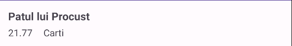

# 05 - Adapter personalizat, meniu, fragmente

## Obiective

- să înțelegeți de ce un rând cu `toString()` nu ajunge pentru o listă reală și cum arată un **layout de rând** personalizat după nevoile aplicației;
- să scrieți un **adapter personalizat** pe `ListView`, cu tiparul **ViewHolder**;
- să adăugați un meniu de opțiuni și să tratați apăsarea fiecărei opțiuni;
- să înțelegeți ce este un **Fragment**, ce face `FragmentManager` și cum arată o **tranzacție** (`replace`) pentru comutarea între fragmente.

Seminarul e dens. Vom prioritiza **adapterul și meniul** pentru a vă asigura că aveți baza, iar fragmentele le puteți continua după ghid acasă.

## De unde porniți

- Starea de la finalul Seminarului 4 (tag `Seminar_4-grupa1086` sau `Seminar_4-grupa1088`, ori branch-ul grupei: `git pull` sau **Clone Repository** din Android Studio - vezi [README](../README.md)).
- `ListView` + `ArrayAdapter` cu `android.R.layout.simple_list_item_1`, CRUD în memorie, FAB, click / long-click. Noi pornim de pe varianta cu `ListView`, așa cum am zis seminarul trecut. Dacă voi ați lucrat cu `RecyclerView`, adaptați codul în consecință.

## 1. De la un simplu `toString()` la un rând personalizat

În Seminarul 4, fiecare element apărea ca un singur șir: `toString()` pe `Anunt` / `Abonament`. În aplicații reale, un rând arată **mai multe** informații odată (titlu și preț, sau nume și cost), uneori pe două linii, poate și cu o imagine. `toString()` nu este suficient pentru layout-uri complexe.

Ca să ajungeți acolo, faceți două lucruri, în ordine:

1. descrieți în XML **cum arată un singur rând** (ce `TextView`-uri are, cum sunt așezate);
2. scrieți un **adapter propriu** care, pentru fiecare poziție din listă, creează din acel XML view-urile rândului (sau reutilizează un rând deja creat) și umple controalele cu date din model.

`ArrayAdapter` cu `simple_list_item_1` știe doar un singur `TextView` din layout-ul Android. Nu cunoaște `tvTitlu` și `tvPret` (sau `tvNume` / `tvCost`) din proiectul vostru. De aceea nu mai folosiți adapterul „gol”: îl extindeți și decideți voi cum se construiește fiecare rând. Primul pas e layout-ul.

## 2. Construim layout-ul unui rând

Creați fișierul care descrie un rând al listei: în proiect, pe `app/src/main/res/layout`, click dreapta → New → Layout Resource File → nume `elem_listview`, root de tip **ConstraintLayout**.

Nu e un ecran, cum era layout-ul unei Activity. Este doar **șablonul** pe care lista îl repetă: de câte ori apare un element, adapterul folosește (sau refolosește) acest layout.

Pe 1086, cel puțin trei informații, de exemplu:

| Id            | Conținut                            |
| ------------- | ----------------------------------- |
| `tvTitlu`     | `getTitlu()`                        |
| `tvPret`      | prețul (formatat ca text)           |
| `tvCategorie` | eticheta categoriei (ca în Spinner) |

Pe 1088: `tvNume`, `tvCost`, `tvFrecventa`.

Exemplu minimal (ConstraintLayout), 1086:

```xml
<?xml version="1.0" encoding="utf-8"?>
<androidx.constraintlayout.widget.ConstraintLayout
    xmlns:android="http://schemas.android.com/apk/res/android"
    xmlns:app="http://schemas.android.com/apk/res-auto"
    android:layout_width="match_parent"
    android:layout_height="wrap_content"
    android:padding="12dp">

    <TextView
        android:id="@+id/tvTitlu"
        android:layout_width="0dp"
        android:layout_height="wrap_content"
        android:textSize="16sp"
        android:textStyle="bold"
        app:layout_constraintStart_toStartOf="parent"
        app:layout_constraintTop_toTopOf="parent"
        app:layout_constraintEnd_toEndOf="parent" />

    <TextView
        android:id="@+id/tvPret"
        android:layout_width="wrap_content"
        android:layout_height="wrap_content"
        android:layout_marginTop="4dp"
        app:layout_constraintStart_toStartOf="parent"
        app:layout_constraintTop_toBottomOf="@id/tvTitlu" />

    <TextView
        android:id="@+id/tvCategorie"
        android:layout_width="wrap_content"
        android:layout_height="wrap_content"
        android:layout_marginStart="16dp"
        app:layout_constraintBaseline_toBaselineOf="@id/tvPret"
        app:layout_constraintStart_toEndOf="@id/tvPret" />

</androidx.constraintlayout.widget.ConstraintLayout>
```

`16sp` de la `textSize` e mărimea textului în **sp** (_scale-independent pixels_): unitatea potrivită pentru fonturi. Spre deosebire de `dp` (folosit la padding, margini, dimensiuni de view), `sp` ține cont și de setarea de mărime a textului din sistemul telefonului. Dacă utilizatorul mărește fonturile din Accesibilitate, textul cu `sp` crește odată cu ele; un text scris greșit în `dp` ar rămâne mic. Valoarea `16` e un titlu de rând rezonabil; nu e obligatorie, puteți alege alta.

`app:layout_constraintBaseline_toBaselineOf` (pe `tvCategorie`, legat de `tvPret`) aliniază **linia de bază** a celor două texte: linia imaginară pe care stau literele (nu marginile de sus sau de jos ale `TextView`-ului). Prețul și categoria apar pe același rând de citit, chiar dacă unul e un pic mai înalt sau are alt `textSize`. Dacă ați lega doar `Top_toTopOf`, cutiile view-urilor s-ar alinia la vârf, iar textul ar putea arăta „sărit” vizual.

Cam așa arată layout-ul unui rând din ListView:



După rebuild, View Binding poate genera `ElemListviewBinding`. În adapterul clasic de `ListView` e obișnuit să folosiți `LayoutInflater` + `findViewById` pe rând. Ambele sunt corecte; la oră rămânem pe inflater, ca să vedeți clar legătura cu `convertView`.

Aveți șablonul. Urmează întrebarea: **cine** îl folosește și **când**, pentru fiecare poziție din listă?

## 3. De ce scriem `getView`

`ListView` nu știe singură cum arată un `Anunt` sau un `Abonament` pe ecran. Când trebuie să afișeze un rând (la start, la derulare, după `notifyDataSetChanged`), îi cere adapterului: „dă-mi view-ul pentru poziția asta”. Metoda pe care o apelează este `getView`. În Seminarul 4, `ArrayAdapter` o implementa el, cu `simple_list_item_1` și `toString()`. Acum **voi** o suprascrieți, ca să folosiți `elem_listview` și câmpurile modelului.

Semnătura:

```java
public View getView(int position, View convertView, ViewGroup parent)
```

- `position`: indexul din `List` (0, 1, 2, …), același ca la click în Seminarul 4;
- `convertView`: un rând **deja creat** pe care `ListView` vi-l oferă spre reutilizare când derulați, sau `null` dacă trebuie unul nou;
- `parent`: lista părinte; îl dați la `inflate` ca să se aplice corect dimensiunile rândului față de listă.

Dacă la fiecare apel ați crea din nou rândul din XML (`inflate`) și ați căuta din nou cele trei `TextView`-uri cu `findViewById`, la o listă lungă derularea ar încetini: crearea din XML e scumpă, iar `findViewById` caută în arborele de view-uri.

**ViewHolder** e tiparul care rezolvă asta:

1. când `convertView == null`, creați rândul din XML, faceți un obiect mic care ține referințele la `TextView`-uri și legați acel obiect de rând cu `setTag`;
2. când `convertView != null`, **nu** mai creați din XML: luați holder-ul din `getTag` și umpleți doar textele.

Pe `RecyclerView` (Seminarul 4, punctul 9), ViewHolder e cerut de API. Pe `ListView` ideea e aceeași, dar o scrieți voi în `getView`. Mai jos puneți ideea în cod: o clasă de adapter și legătura cu `ListView`.

## 4. Scriem adapterul și îl legăm de listă

Pentru textul categoriei (sau frecvenței) pe rând folosiți `Categorie.etichetaDin` / `Frecventa.etichetaDin` pe care le-ați adăugat pe enum în Seminarul 4.

Creați clasa `ro.ase.semdam.adapters.CustomAdapter` (sau `AnuntListAdapter`) care extinde `ArrayAdapter<Anunt>` (1088: `ArrayAdapter<Abonament>`). Aici trăiesc `ViewHolder` și `getView`.

**Constructor:** în Java nu „suprascrieți” un constructor ca pe o metodă (`@Override` nu se pune pe constructori). Scrieți un constructor în subclasă care apelează pe cel din părinte cu `super(...)`. `ArrayAdapter` are deja `ArrayAdapter(Context, int, List<T>)` (același tipar ca în Seminarul 4). În Android Studio, pe clasă: Alt+Insert (sau click dreapta → Generate) → **Constructor** → alegeți varianta cu `Context`, `resource` și `List`. IDE-ul generează semnătura și apelul `super`. Folosiți **această** variantă.

```java
package ro.ase.semdam.adapters;

import android.content.Context;
import android.view.LayoutInflater;
import android.view.View;
import android.view.ViewGroup;
import android.widget.ArrayAdapter;
import android.widget.TextView;

import androidx.annotation.NonNull;
import androidx.annotation.Nullable;

import java.util.List;

import ro.ase.semdam.R;
import ro.ase.semdam.domeniu.Anunt;
import ro.ase.semdam.domeniu.Categorie;

public class CustomAdapter extends ArrayAdapter<Anunt> {

    private static class ViewHolder {
        TextView tvTitlu;
        TextView tvPret;
        TextView tvCategorie;
    }

    public CustomAdapter(@NonNull Context context, int resource, @NonNull List<Anunt> objects) {
        super(context, resource, objects);
    }

    @NonNull
    @Override
    public View getView(int position, @Nullable View convertView, @NonNull ViewGroup parent) {
        ViewHolder holder;
        if (convertView == null) {
            convertView = LayoutInflater.from(getContext())
                    .inflate(R.layout.elem_listview, parent, false);
            holder = new ViewHolder();
            holder.tvTitlu = convertView.findViewById(R.id.tvTitlu);
            holder.tvPret = convertView.findViewById(R.id.tvPret);
            holder.tvCategorie = convertView.findViewById(R.id.tvCategorie);
            convertView.setTag(holder);
        } else {
            holder = (ViewHolder) convertView.getTag();
        }

        Anunt anunt = getItem(position);
        if (anunt != null) {
            holder.tvTitlu.setText(anunt.getTitlu());
            holder.tvPret.setText(String.valueOf(anunt.getPret()));
            holder.tvCategorie.setText(Categorie.etichetaDin(anunt.getCategorie()));
        }
        return convertView;
    }
}
```

`@NonNull` și `@Nullable` (din `androidx.annotation`) sunt **adnotări**: îi spun IDE-ului și Lint-ului dacă un parametru sau o valoare de retur are voie să fie `null`. Nu schimbă singure comportamentul la runtime ca un `if`; vă ajută să prindeți greșeli din editor. Pe constructorul generat apar pe `context` și pe listă; pe `getView`, `@Nullable` la `convertView` e important: primul apel (sau când nu există rând de reciclat) vine cu `null`.

#### Ce face `getView`, pas cu pas

`ListView` apelează `getView` de fiecare dată când are nevoie de un rând pe ecran. Nu creați voi o buclă `for` peste listă: platforma decide **când** și pentru **ce `position`**.

1. **`convertView`** este rândul pe care lista vi-l propune spre **reutilizare**. Imagineați-vă că pe ecran încap vreo 8 rânduri. Când derulați, rândul de sus iese din ecran; `ListView` nu îl aruncă, ci vi-l dă înapoi la următorul `getView`, ca să-l umpleți cu datele de la altă poziție. Prima dată (sau când nu mai are rând liber), `convertView` este `null`: trebuie să creați unul nou din XML.

2. **Ramura `convertView == null`:**
   - `inflate(R.layout.elem_listview, ...)` citește XML-ul și construiește ierarhia de view-uri (rădăcina + cele trei `TextView`-uri).
   - `findViewById` găsește fiecare control după id. Asta e relativ scump dacă o faceți la fiecare derulare.
   - De aceea creați un **`ViewHolder`**: o cutie mică (clasă statică interioară) care ține doar referințele `tvTitlu`, `tvPret`, `tvCategorie`. O dată ce le-ați găsit, le păstrați acolo.

3. **`setTag` / `getTag`:** fiecare `View` pe Android poate ține un obiect arbitrar „agățat” de el, fără să fie un câmp al layout-ului. Cu `convertView.setTag(holder)` lipiți holder-ul de **acel** rând. La următoarea reutilizare, `convertView` e același obiect vizual, iar `(ViewHolder) convertView.getTag()` vă dă înapoi cutia cu cele trei `TextView`-uri, **fără** `inflate` și **fără** `findViewById` din nou.  
   În PAW (WinForms), e același rol ca proprietatea **`Tag`** a unui control: `button1.Tag = ceva;` / `var x = button1.Tag;`. Framework-ul nu știe ce e înăuntru; voi puneți și voi citiți. Pe Android, `setTag` / `getTag` sunt perechea echivalentă: asociați date auxiliare (aici, ViewHolder-ul) la view-ul rândului.

4. **Ramura `else` (`convertView != null`):** rândul există deja; doar recuperați holder-ul din tag. Nu mai creați XML.

5. **Umplerea cu date** (după `if` / `else`, pentru **ambele** ramuri): `getItem(position)` ia `Anunt`-ul (sau `Abonament`-ul) din listă; puneți textele pe `holder.tv...`. Rândul vizual e vechi sau nou, dar **conținutul** trebuie să fie al poziției curente. Dacă ați uita acest pas la reciclare, ați vedea pe ecran datele vechi ale altui element.

6. **`return convertView`:** îi dați listei view-ul rândului, gata de afișat.

Pe 1088: aceleași idei, cu id-urile `tvNume` / `tvCost` / `tvFrecventa` și `Frecventa.etichetaDin(...)`.

Parametrul `resource` din constructor e layout-ul pe care `ArrayAdapter` l-ar folosi **dacă nu** ați suprascrie `getView` (ca `simple_list_item_1` în Seminarul 4). Voi creați rândul în `getView` cu `R.layout.elem_listview`, deci `resource` nu mai decide cum arată lista. La creare puteți trece `0` (e o convenție: „layout-ul e doar în `inflate`”) sau `R.layout.elem_listview` (documentează intenția); cu `getView` suprascris, ambele sunt acceptabile.

În `MainActivity`, înlocuiți adapterul vechi:

```java
adapter = new ArrayAdapter<>(this, android.R.layout.simple_list_item_1, anunturi);
```

cu:

```java
adapter = new CustomAdapter(this, 0, anunturi);
binding.lvElemente.setAdapter(adapter);
```

Tipul câmpului poate rămâne `ArrayAdapter<Anunt>` (fiindcă adapterul extinde `ArrayAdapter<Anunt>` - ăsta e conceptul de polimorfism 😉). Deși puteți declara `CustomAdapter adapter`, este recomandat să folosiți tipul general pentru a respecta principiul **programării orientate pe superclase/interfețe, nu pe implementări**, cum vă spune și la CTS. Click-ul, long-click-ul și `notifyDataSetChanged()` rămân neschimbate: tot pe `ListView` lucrați. Dacă lista arată titlu, preț și categorie pe fiecare rând, adapterul e legat corect.

Documentație: [ArrayAdapter](https://developer.android.com/reference/android/widget/ArrayAdapter), [LayoutInflater.inflate](<https://developer.android.com/reference/android/view/LayoutInflater#inflate(int,%20android.view.ViewGroup,%20boolean)>), [View.setTag](<https://developer.android.com/reference/android/view/View#setTag(java.lang.Object)>)

Lista e personalizată. Urmează o altă piesă din UI-ul unei aplicații: meniul din bara de sus.

## 5. Adăugăm meniul din bara de acțiune

**Options menu** e meniul din bara de acțiune (sau din cele trei puncte). Nu e un `Button` pe layout-ul principal: e un fișier XML în `res/menu/`, pe care Activity-ul îl încarcă și îl tratează în cod.

În proiectul vostru, după șablonul Empty Views Activity, **nu există încă** folderul `res/menu/`. Nu trebuie să-l creați manual ca director gol. Îl obțineți odată cu primul fișier de meniu:

1. În Android Studio, click dreapta pe `app/src/main/res` → **New → Android Resource File**.
2. La **File name**: `meniu_principal` (fără `.xml`; IDE-ul îl adaugă).
3. La **Resource type**: alegeți **Menu**. Câmpul **Directory name** se completează singur cu `menu`. Confirmă cu OK.
4. Android Studio creează `app/src/main/res/menu/` (dacă lipsea) și fișierul `meniu_principal.xml` înăuntru. În cod va apărea ca `R.menu.meniu_principal`.

Dacă alegeți greșit Resource type (de exemplu Layout), fișierul ajunge în alt folder din `res/` și `R.menu...` nu există. Ștergeți greșeala și recreați cu tipul Menu.

În `meniu_principal.xml`, adăugați iteme, de exemplu:

```xml
<?xml version="1.0" encoding="utf-8"?>
<menu xmlns:android="http://schemas.android.com/apk/res/android"
    xmlns:app="http://schemas.android.com/apk/res-auto">

    <item
        android:id="@+id/action_bnr"
        android:title="Curs BNR"
        app:showAsAction="never" />

    <item
        android:id="@+id/action_despre"
        android:title="Despre"
        app:showAsAction="never" />
</menu>
```

`showAsAction="never"` ține itemul în overflow (cele trei puncte). `ifRoom` îl arată pe bară dacă încape.

În `MainActivity` legați meniul de ecran:

```java
@Override
public boolean onCreateOptionsMenu(Menu menu) {
    getMenuInflater().inflate(R.menu.meniu_principal, menu);
    return true;
}

@Override
public boolean onOptionsItemSelected(@NonNull MenuItem item) {
    int id = item.getItemId();
    if (id == R.id.action_despre) {
        Toast.makeText(this, "Aplicație seminar DAM", Toast.LENGTH_SHORT).show();
        return true;
    }
    if (id == R.id.action_bnr) {
        // BnrActivity: într-un seminar viitor; acum doar Toast
        Toast.makeText(this, "Curs BNR: în curând", Toast.LENGTH_SHORT).show();
        return true;
    }
    return super.onOptionsItemSelected(item);
}
```

`onCreateOptionsMenu` creează conținutul meniului din XML (tot cu `inflate`, ca la layout). `onOptionsItemSelected` reacționează la apăsare: verificați `id`-ul itemului și tratați cazul. `return true` spune că ați tratat itemul. Dacă se selectează un item care nu e de interes pentru voi, i.e. nu vreți să facă nimic, lăsați `super` să îl trateze.

Rulați aplicația și căutați meniul (cele trei puncte) sus pe ecran… și, de regulă, **surpriză: nu apare**. Codul e în regulă; lipsește locul unde Android afișează options menu.

#### De ce nu apare: `NoActionBar` + ce facem modern

Meniul options se afișează pe o **bară de sus**. Șablonul folosește `Theme.Material3.DayNight.NoActionBar`: tema **nu** pune singură o Action Bar clasică. Asta e intenționat în proiectele actuale: bara o adăugați voi în layout, ca un view obișnuit.

Nu schimbați tema în `Theme.Material3.DayNight` (fără `NoActionBar`) și **nu** scoateți `EdgeToEdge.enable`. În Seminarul 1 ați văzut de ce edge-to-edge rămâne: pe API noi e comportamentul așteptat; „oprirea” lui ca să reapare Action Bar-ul vechi e un ocol, nu varianta pe care o vrem.

Varianta modernă:

1. **Păstrați** `NoActionBar` și `EdgeToEdge.enable(this)`.
2. În `activity_main.xml`, adăugați un `MaterialToolbar` sus. `ListView` nu mai e legat de `parent` sus, ci de **sub** toolbar.

```xml
<com.google.android.material.appbar.MaterialToolbar
    android:id="@+id/toolbar"
    android:layout_width="0dp"
    android:layout_height="?attr/actionBarSize"
    android:background="?attr/colorPrimary"
    app:title="@string/app_name"
    app:layout_constraintTop_toTopOf="parent"
    app:layout_constraintStart_toStartOf="parent"
    app:layout_constraintEnd_toEndOf="parent" />
```

`?attr/...` nu e o dimensiune sau o culoare scrisă de mână: e o **referință la un atribut al temei**. La runtime, Android ia valoarea definită de tema curentă (`Theme.Material3.DayNight...` din `themes.xml`).

- `?attr/actionBarSize`: înălțimea standard a barei de sus (de obicei în jur de 56 dp). Dacă mâine schimbați tema sau densitatea ecranului, toolbar-ul rămâne „cât trebuie” fără să hardcodați `56dp`.
- `?attr/colorPrimary`: culoarea primară a temei (cea pe care Material o folosește pentru accente / app bar). Toolbar-ul se potrivește vizual cu restul aplicației; dacă schimbați `colorPrimary` în temă, se actualizează și fundalul barei.

`app:title="@string/app_name"` pune pe bară numele din `strings.xml` (același ca pe launcher).

La `ListView` (sau `RecyclerView`), înlocuiți `app:layout_constraintTop_toTopOf="parent"` cu:

```xml
app:layout_constraintTop_toBottomOf="@id/toolbar"
```

FAB-ul rămâne ancorat de colțul din dreapta-jos al părintelui. Listener-ul de insets de pe `main` rămâne ca în Seminarul 1.

3. În `onCreate`, după `setContentView` (și View Binding), spuneți framework-ului că **aceasta** e bara pentru options menu:

```java
setSupportActionBar(binding.toolbar);
```

Rulați din nou: titlu pe toolbar, overflow cu „Despre” / „Curs BNR”, lista sub bară, edge-to-edge păstrat. (La fragmente veți adăuga a treia opțiune, care deschide `HostActivity`.)

Documentație: [Menus](https://developer.android.com/develop/ui/views/components/menus), [Set up the app bar](https://developer.android.com/develop/ui/views/components/appbar)

### Live assignment

Al doilea live assignment din semestru (seminariile cu live assignments: 3, 5, 7 și 11; vezi [README](../README.md)). Extindeți **rândul** din listă și **meniul** din toolbar, pe baza adapterului și a meniului de opțiuni din acest seminar. **Cerința exactă se anunță la oră** pe Moodle, separat pe fiecare grupă.

### Evaluare

- **Pondere:** 5% din nota finală (unul din cele patru live assignments; împreună 20%).
- **Mod:** verificare pe calculatorul vostru, la oră, cu un demo propus de mine.
- **Condiție pentru a primi punctaj:** treceți demo-ul (rândul arată câmpul cerut; stilul din `getView` e corect; opțiunea de meniu afișează totalul așteptat, inclusiv pe listă goală).
- **Fără punctaj intermediar:** live assignment-ul este totul sau nimic. Ori primiți cei 5%, ori 0 pentru acest exercițiu.

Partea cu fragmente (secțiunile 6-7) o puteți continua acasă dacă nu mai avem timp în oră; **nu** intră în live assignment.

## 6. Ce este un Fragment?

Până acum fiecare ecran a fost o **Activity**. Uneori nu vreți un ecran nou întreg, ci o **bucată de UI** în cadrul aceluiași ecran: un panou de detalii lângă listă, un ecran „Despre” în același container, tab-uri. Asta e un **Fragment**: o porțiune reutilizabilă de UI, cu **ciclu de viață propriu**, găzduită de o Activity. Nu înlocuiește Activity-ul: stă **în** el.

|          | Activity                              | Fragment                                      |
| -------- | ------------------------------------- | --------------------------------------------- |
| Rol      | ecran (fereastră) gestionat de sistem | parte din ecran, în cadrul unei Activity      |
| Manifest | obligatoriu                           | de regulă din cod sau din XML, în container   |
| Exemple  | `MainActivity`, `AddActivity`         | listă + panou detalii, tab-uri, UI pe tabletă |

Cine le administrează? **`FragmentManager`** (din `AppCompatActivity`: `getSupportFragmentManager()`). Când adăugați, înlocuiți sau scoateți un fragment, grupați operațiile într-o **tranzacție** (`add`, `replace`, `remove`) și o aplicați cu `commit()`.

Unde stă fragmentul pe ecran? Într-un container din layout-ul Activity-ului. Recomandat: `FragmentContainerView`.

Folosiți `androidx.fragment.app.Fragment`, **nu** `android.app.Fragment` (API vechi).

Atenție la rotație: Activity-ul poate fi recreat. Dacă adăugați din nou fragmentul inițial fără să verificați `savedInstanceState == null`, riscați **două** instanțe. Fragmentul de start se adaugă doar la prima creare.

În proiecte moderne apare des Navigation Component (graf de navigare). Aici faceți tranzacțiile **manual**, ca să înțelegeți mecanismul cerut și de fișa disciplinei. În secțiunea următoare: un container, două fragmente, comutare cu `replace`.

## 7. Comutăm între două fragmente

Nu atașați demo-ul de fragmente pe `MainActivity` (acolo e lista). Faceți un ecran gazdă separat: **`HostActivity`**, cu un container și un buton care comută între două fragmente.

Aveți nevoie de patru piese: **`HostActivity`**, layout-ul ei cu **container + buton**, **două fragmente** (fiecare cu layout) și **codul** din `HostActivity` care le pune pe rând în container.

### 7.1. HostActivity

Pe pachetul `ro.ase.semdam` (lângă `MainActivity`): **New → Activity → Empty Views Activity** → nume `HostActivity`, Language **Java**. Șablonul înregistrează Activity-ul în Manifest și creează `activity_host.xml`. View Binding îl adăugați voi, ca la `AddActivity` / `SecondActivity`.

Deschideți-o din toolbar: o **a treia** opțiune în `meniu_principal.xml`:

```xml
<item
    android:id="@+id/action_fragmente"
    android:title="Fragmente"
    app:showAsAction="never" />
```

În `MainActivity`, în `onOptionsItemSelected`, adăugați ramura (lângă „Despre” și „Curs BNR”):

```java
if (id == R.id.action_fragmente) {
    startActivity(new Intent(this, HostActivity.class));
    return true;
}
```

Import: `android.content.Intent` (dacă lipsește). Overflow-ul are acum trei iteme; „Fragmente” pornește `HostActivity`.

### 7.2. Layout-ul gazdei (`activity_host.xml`)

Rădăcina rămâne **ConstraintLayout** (cu `android:id="@+id/main"`, ca în celelalte ecrane). Înăuntru: un **`FragmentContainerView`** (zona unde se afișează fragmentul) și un **`Button`** sub el (comutarea).

Exemplu de layout:

```xml
<?xml version="1.0" encoding="utf-8"?>
<androidx.constraintlayout.widget.ConstraintLayout
    xmlns:android="http://schemas.android.com/apk/res/android"
    xmlns:app="http://schemas.android.com/apk/res-auto"
    android:id="@+id/main"
    android:layout_width="match_parent"
    android:layout_height="match_parent">

    <androidx.fragment.app.FragmentContainerView
        android:id="@+id/fragment_container"
        android:layout_width="0dp"
        android:layout_height="0dp"
        app:layout_constraintTop_toTopOf="parent"
        app:layout_constraintBottom_toTopOf="@id/btnComuta"
        app:layout_constraintStart_toStartOf="parent"
        app:layout_constraintEnd_toEndOf="parent" />

    <Button
        android:id="@+id/btnComuta"
        android:layout_width="0dp"
        android:layout_height="wrap_content"
        android:layout_margin="16dp"
        android:text="Comută fragment"
        app:layout_constraintBottom_toBottomOf="parent"
        app:layout_constraintStart_toStartOf="parent"
        app:layout_constraintEnd_toEndOf="parent" />

</androidx.constraintlayout.widget.ConstraintLayout>
```

### 7.3. Cele două fragmente (pachet `fragments`)

Rămâneți organizați: pe `ro.ase.semdam`, **New → Package** → `fragments`. Apoi **click dreapta pe pachetul `fragments`** → **New → Fragment → Fragment (Blank)**, Language **Java**. Creați `ListaFragment` și `InfoFragment` (fiecare cu layout-ul generat: `fragment_lista.xml`, `fragment_info.xml`).

Șablonul Blank Fragment vine cu un exemplu de **transmitere de argumente** prin `Bundle`. Nu e obligatoriu pentru demo; aplicația pornește și dacă îl lăsați. Ce face fiecare piesă:

| Piesă                                              | Rol                                                                                                   |
| -------------------------------------------------- | ----------------------------------------------------------------------------------------------------- |
| Constructorul public gol                           | Obligatoriu: sistemul recreează fragmentul fără argumente în constructor                              |
| `ARG_PARAM1` / `ARG_PARAM2`, `mParam1` / `mParam2` | Chei și câmpuri pentru două string-uri „param1” / „param2” din exemplu                                |
| `newInstance(param1, param2)`                      | Fabrică: creează fragmentul, pune valorile în `Bundle` cu `setArguments`, returnează instanța         |
| `onCreate` + `getArguments()`                      | Citește Bundle-ul setat de `newInstance` (sau din stare salvată)                                      |
| **`onCreateView`**                                 | Ce contează aici: face inflate layout-ului XML al fragmentului (același tipar ca la un rând de listă) |

Pentru comutarea simplă folosiți `new ListaFragment()` / `new InfoFragment()`. Nu aveți nevoie de `newInstance` dacă nu trimiteți date. Puteți șterge `ARG_*`, câmpurile, `newInstance` și corpul din `onCreate` care citește argumentele, ca să rămână clasa scurtă; esențial e `onCreateView` cu `inflate`.

Ca să vedeți clar că sunt **două** ecrane diferite în același container, schimbați textul din boilerplate pe fiecare layout. În `fragment_lista.xml`, pe `TextView`-ul generat:

```xml
android:text="Fragment listă"
```

În `fragment_info.xml`:

```xml
android:text="Fragment info"
```

### 7.4. Codul din HostActivity

În `HostActivity`, în **`onCreate`**, View Binding + insets ca la celelalte Activity-uri (`ActivityHostBinding`). Tot în `onCreate`, după `setContentView`, adăugați fragmentul de start **doar la prima creare** a ecranului:

```java
if (savedInstanceState == null) {
    getSupportFragmentManager()
            .beginTransaction()
            .setReorderingAllowed(true)
            .add(R.id.fragment_container, new ListaFragment())
            .commit();
}
```

De ce `savedInstanceState == null`? Dacă rotiți emulatorul (portrait ↔ landscape), Android **distruge și recreează** `HostActivity`. `FragmentManager` restaurează singur fragmentul deja afișat. Fără condiție, ați apela din nou `add` și ați risca **două** instanțe în container. La prima deschidere, `savedInstanceState` e `null`; după recreare din cauza rotației (sau a altei schimbări de configurație), nu mai e.

Importați fragmentele din `ro.ase.semdam.fragments`. Tot în `onCreate`, legați butonul: țineți un câmp boolean (de exemplu `afiseazaInfo`) ca să alternați la fiecare apăsare pe `btnComuta`:

```java
private boolean afiseazaInfo;

// în onCreate, după binding + insets + fragmentul de start:
binding.btnComuta.setOnClickListener(v -> {
    afiseazaInfo = !afiseazaInfo;
    Fragment urmatorul = afiseazaInfo ? new InfoFragment() : new ListaFragment();
    getSupportFragmentManager()
            .beginTransaction()
            .setReorderingAllowed(true)
            .replace(R.id.fragment_container, urmatorul)
            .addToBackStack(null) // opțional: Back revine la fragmentul anterior
            .commit();
});
```

`Fragment` din tipul variabilei e `androidx.fragment.app.Fragment`. `replace` scoate fragmentul curent din container și pune pe cel nou. `addToBackStack` permite butonului Back să refacă starea anterioară; fără el, Back închide `HostActivity`.

Opțional: `Log.d` în `onCreateView` / `onViewCreated` ale fragmentului și în lifecycle-ul `HostActivity`, ca să vedeți în Logcat ordinea apelurilor.

Documentație: [Create a fragment](https://developer.android.com/guide/fragments/create), [FragmentManager](https://developer.android.com/guide/fragments/fragmentmanager), [FragmentContainerView](https://developer.android.com/reference/androidx/fragment/app/FragmentContainerView)

## Verificare

- [ ] Rândurile din `ListView` folosesc `elem_listview.xml`, nu doar `toString()` pe un singur `TextView`.
- [ ] Adapterul propriu folosește ViewHolder (`setTag` / `getTag`) și `convertView`.
- [ ] Meniul din bara de acțiune are „Despre”, „Curs BNR” (Toast e suficient pentru BNR acum) și, după fragmente, „Fragmente” (deschide `HostActivity`).
- [ ] Live assignment (anunțat la oră): câmpul cerut pe rând, regula de stil din `getView`, totalul din meniu (inclusiv 0 pe listă goală).
- [ ] `HostActivity` are `FragmentContainerView` + buton; `ListaFragment` / `InfoFragment` sunt în pachetul `fragments` și arată texte diferite.
- [ ] Puteți comuta între cele două fragmente; după rotirea emulatorului nu apar duplicate la start (`savedInstanceState == null`).
- [ ] Puteți explica pe scurt: de ce ViewHolder, ce face `onCreateOptionsMenu`, de ce există fragmente față de o Activity nouă pentru fiecare panou.

## Bibliografie

- [Fragments](https://developer.android.com/guide/fragments)
- [Menus](https://developer.android.com/develop/ui/views/components/menus)
- [ArrayAdapter](https://developer.android.com/reference/android/widget/ArrayAdapter)

## Indexul ghidurilor

| Fișier                                                                     | Temă                                    |
| -------------------------------------------------------------------------- | --------------------------------------- |
| [01-proiect-activity-view-binding.md](01-proiect-activity-view-binding.md) | Proiect, Activity, View Binding, Intent |
| [02-formular-si-model.md](02-formular-si-model.md)                         | Formular, controale, model (POJO)       |
| [03-validare-activity-result.md](03-validare-activity-result.md)           | Validare, Activity Result API           |
| [04-lista-crud-memorie.md](04-lista-crud-memorie.md)                       | ListView, CRUD în memorie               |
| [05-adapter-meniu-fragmente.md](05-adapter-meniu-fragmente.md)             | Adapter personalizat, meniu, fragmente  |
| [06-retea-xml-bnr.md](06-retea-xml-bnr.md)                                 | Rețea asincronă, XML BNR                |
| [07-json-sharedpreferences.md](07-json-sharedpreferences.md)               | JSON, SharedPreferences                 |
| [08-proba1.md](08-proba1.md)                                               | Proba practică 1                        |
| [09-room.md](09-room.md)                                                   | Room (SQLite)                           |
| [10-firebase.md](10-firebase.md)                                           | Firebase Realtime Database              |
| [11-grafica-canvas.md](11-grafica-canvas.md)                               | Grafică 2D pe Canvas                    |
| [12-proba2.md](12-proba2.md)                                               | Proba practică 2                        |
| [13-recapitulare-publicare.md](13-recapitulare-publicare.md)               | Recapitulare, hărți (demo), publicare   |
